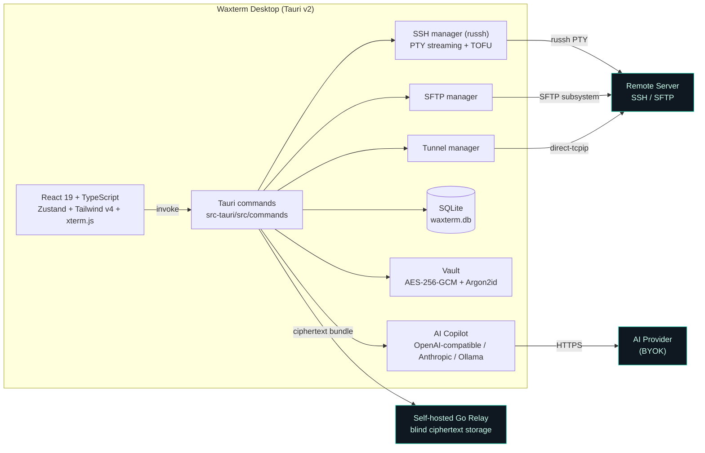
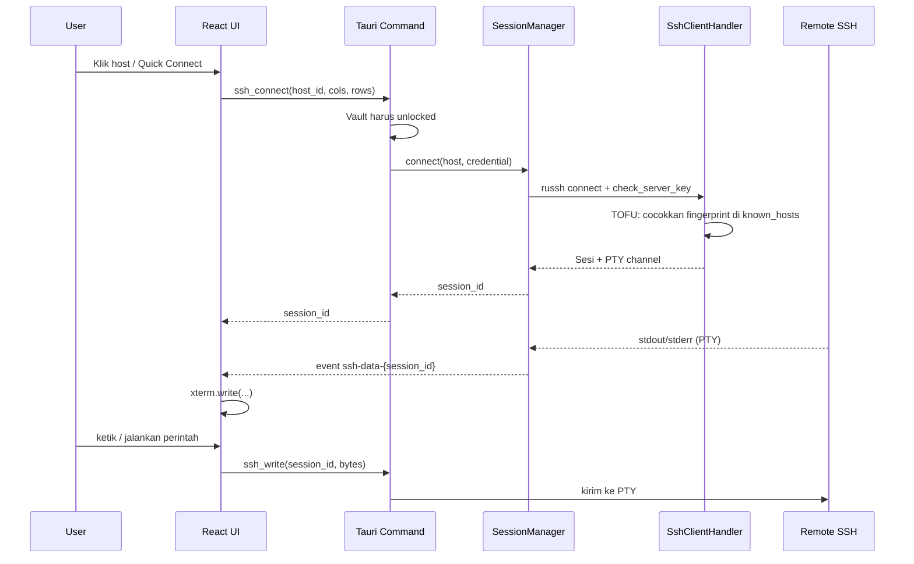
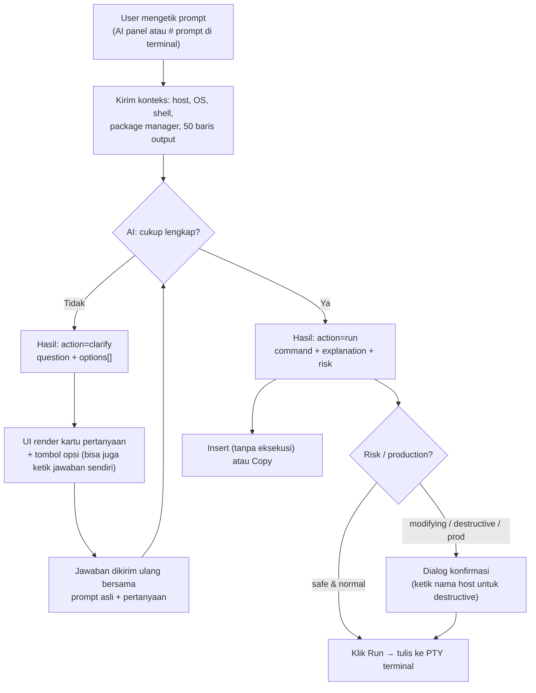

# Waxterm

**AI-powered SSH client & server manager** — a local-first, zero-knowledge desktop app for Linux, macOS, and Windows.

Waxterm adalah port dari arsitektur **[Termimus](https://github.com/termimus/termimus-ssh)** (Tauri v2 + Rust + React 19 + xterm.js), dengan satu perbedaan utama: **AI Copilot yang bisa bertanya balik dengan opsi** ketika permintaan pengguna belum lengkap, sebelum menghasilkan dan menjalankan perintah di terminal.

- **Local-first** — database SQLite berjalan 100% offline di mesin Anda.
- **Native SSH** — koneksi, PTY, SFTP, dan tunnel memakai engine Rust (`russh`), bukan memanggil binary `ssh`.
- **Zero-knowledge vault** — password, private key, dan API key dienkripsi AES-256-GCM dengan key turunan Argon2id.
- **Self-hosted sync** — relay Go yang hanya menyimpan ciphertext (blind relay).

---

## Daftar Isi

1. [Arsitektur](#arsitektur)
2. [Cara Kerja Koneksi](#cara-kerja-koneksi)
3. [Alur AI Copilot (pembeda utama)](#alur-ai-copilot-pembeda-utama)
4. [Fitur](#fitur)
5. [Struktur Repo](#struktur-repo)
6. [Menjalankan](#menjalankan)
7. [Sync Server (opsional)](#sync-server-opsional)
8. [Model Keamanan](#model-keamanan)
9. [Verifikasi](#verifikasi)
10. [Lisensi & Atribusi](#lisensi--atribusi)

---

## Arsitektur



**Prinsip arsitektur**

| Lapisan | Teknologi | Tanggung jawab |
|---|---|---|
| UI | React 19, TypeScript, Vite 8, Tailwind CSS v4, Zustand, `@xterm/xterm` 6 | Sidebar, host list, terminal tabs + split panes, SFTP, tunnels, snippets, settings, AI panel |
| Jembatan | Tauri `invoke` | Semua panggilan ke backend lewat `src/lib/api.ts` (satu pintu, typed wrapper) |
| Backend | Rust: `russh`, `rusqlite`, `aes-gcm`, `argon2`, `reqwest` | SSH/PTY, SFTP, tunnel, database, vault, AI client |
| Penyimpanan | SQLite (`waxterm.db`) | Hosts, folder, credential terenkripsi, known hosts, snippet, tunnel, workspace, provider AI |
| Sync | Go + SQLite (modernc, tanpa CGO) | Blind relay + WebSocket `SYNC_UPDATED` |

**Keputusan penting (mengikuti Termimus):**

- Semua koneksi SSH-family (terminal, SFTP, tunnel) wajib melewati `SshClientHandler` + `Arc<Database>` supaya verifikasi host key TOFU/MITM berlaku seragam.
- Kredensial tidak pernah disimpan plaintext. `Credential.ciphertext`/`nonce` adalah output AES-256-GCM; enkripsi/dekripsi hanya lewat `VaultManager`.
- Terminal tidak pernah `display: none` (pakai `visibility: hidden` + `pointerEvents: none`) agar `htop`/`vim` tidak rusak akibat SIGWINCH 0×0.
- Backend menggabungkan chunk PTY (~8 ms / 64 KB) sebelum mengirim event `ssh-data-{sessionId}`.

---

## Cara Kerja Koneksi

### 1. Simpan host + kredensial

1. **Host modal** mengirim `host_save` dengan `auth_method`: `password`, `private_key`, atau `agent`.
2. Jika ada secret, backend mengenkripsinya lewat `VaultManager` lalu menyimpan sebagai `Credential` di SQLite.
3. Private key dapat diimpor ke **Keychain**; public key + SHA-256 fingerprint diturunkan otomatis untuk ditempel ke `authorized_keys`.

### 2. Buka terminal (1-klik)



- **2FA / keyboard-interactive** ditangani lewat `AuthPromptModal` → `ssh_auth_prompt_respond`.
- **SFTP** memakai koneksi terpisah namun handler host-key yang sama; mendukung transfer lokal↔remote dan remote↔remote.
- **Tunnel** mendukung local (`-L`), remote (`-R`), dan dynamic SOCKS5 (`-D`) lewat `channel_open_direct_tcpip`.
- **Ping/latency** diukur per host lewat command Rust (`ping_host` / `ping_hosts`).

### 3. Sinkronisasi antar perangkat (opsional)

Client membuat `BackupBundle` terenkripsi, mengirimnya ke relay Go, dan perangkat lain menarik + melakukan merge. Server tidak memiliki key, sehingga tidak bisa membaca isi bundle.

---

## Alur AI Copilot (pembeda utama)

Waxterm mempertahankan perilaku AI yang diminta:

> **user → prompt → AI mencari kebutuhan perintah yang relevan → jika prompt kurang lengkap, AI bertanya balik dengan opsi → user memilih → AI menghasilkan perintah → konfirmasi → jalankan di terminal.**

### Kontrak output AI

Model **wajib** membalas satu objek JSON saja.

**Jika permintaan sudah lengkap** — langsung hasilkan perintah:

```json
{
  "action": "run",
  "command": "df -h --output=source,size,used,avail,pcent,target | sort -k5 -hr | head -n 10",
  "explanation": "Menampilkan 10 filesystem dengan penggunaan tertinggi.",
  "risk": "safe",
  "needs_sudo": false
}
```

**Jika ada detail yang hilang** — tanya satu pertanyaan + 2–4 opsi:

```json
{
  "action": "clarify",
  "question": "Direktori mana yang ingin dibersihkan?",
  "options": [
    { "label": "Cache Docker", "value": "/var/lib/docker" },
    { "label": "Log sistem", "value": "/var/log" },
    { "label": "Cache paket", "value": "/var/cache/apt" }
  ],
  "explanation": "Target path mengubah perintah dan dampaknya.",
  "command": "",
  "risk": "safe",
  "needs_sudo": false
}
```

### Alur UI



**Detail implementasi**

| Bagian | Lokasi |
|---|---|
| System prompt + aturan `run`/`clarify` | `src-tauri/src/ai/prompt.rs` |
| Parser JSON + normalisasi opsi + risk classifier lokal | `src-tauri/src/ai/command.rs` |
| Streaming SSE + cancel + redaksi error | `src-tauri/src/ai/client.rs` |
| Deteksi OS/shell/package manager (exec channel tersembunyi) | `src-tauri/src/ai/environment.rs` |
| Sanitasi output terminal (secret redaction) | `src-tauri/src/ai/sanitizer.rs` |
| Command `ai_generate_terminal_command` | `src-tauri/src/commands/mod.rs` |
| Tipe hasil + wrapper `invoke` | `src/lib/api.ts` |
| State, streaming preview, follow-up prompt | `src/stores/useAiStore.ts` |
| Kartu klarifikasi + tombol opsi | `src/components/terminal/AiSidebar.tsx` |

**Keamanan AI**

- **Risk classifier lokal** hanya bisa menaikkan level risiko model, tidak pernah menurunkannya.
- Perintah `destructive` dan host bertanda produksi selalu butuh konfirmasi eksplisit.
- Perintah AI tidak pernah dikirim ke grup terminal broadcast.
- Private key, token, password, dan header `Authorization` di-redact dari output terminal sebelum dikirim ke provider.
- API key provider disimpan sebagai credential vault (AES-256-GCM).

---

## Fitur

### Terminal & koneksi
- Multi-tab terminal, split pane (vertikal/horizontal), drag-and-drop tab, auto-grouping.
- Input broadcast (`Alt+B`) untuk menjalankan perintah yang sama di beberapa server sekaligus.
- Quick Connect (`Ctrl+K`) dengan pencarian fuzzy.
- 2FA / keyboard-interactive, TOFU host-key verification, ping/latency.

### Hosts & keychain
- Folder host, tag, jump host, catatan, riwayat koneksi terakhir.
- Vault private key (OpenSSH/PEM/PuTTY), derive public key + fingerprint.
- Identity password reusable, reveal/copy key saat vault unlocked.

### SFTP & editor
- Dual-pane local ↔ remote, transfer remote ↔ remote.
- Edit file langsung dengan syntax highlighting dan `Ctrl+S`.

### Tunnels, snippets, workspaces
- Port forwarding local/remote/SOCKS5 dengan status live.
- Snippet library + inject ke terminal aktif.
- Workspace preset layout multi-server + 1-click cluster launch.

### AI Copilot
- BYOK: OpenAI-compatible, Anthropic, Ollama lokal (auto-list model).
- Generate command, explain error, inline `# prompt`.
- **Klarifikasi ber-opsi** (fitur pembeda) dengan `action: "clarify"`.
- Streaming, stop/cancel, riwayat, insert vs run.

### Keamanan & sync
- Vault AES-256-GCM + Argon2id, auto-lock, OS keyring, backup/restore terenkripsi.
- Self-hosted sync relay (Go) dengan WebSocket real-time.
- i18n: English, Bahasa Indonesia, 简体中文.

---

## Struktur Repo

```text
waxterm/
├── src/                          # React 19 frontend
│   ├── components/
│   │   ├── layout/               # Header, Sidebar, QuickConnect, confirm modal
│   │   ├── hosts/                # Host & folder management
│   │   ├── terminal/             # xterm view, tabs/splits, AI sidebar, confirm dialog
│   │   ├── keychain/             # Key & identity vault
│   │   ├── sftp/                 # Dual-pane SFTP + editor
│   │   ├── tunnels/              # Port forwarding
│   │   ├── snippets/             # Script library
│   │   ├── workspaces/           # Layout presets / cluster launcher
│   │   ├── settings/             # General, terminal, AI provider
│   │   ├── vault/                # Lock screen, backup/restore
│   │   └── sync/                 # Self-hosted sync UI
│   ├── stores/                   # Satu Zustand store per domain
│   ├── lib/api.ts                # Satu-satunya tempat `invoke(...)`
│   ├── lib/aiContext.ts          # Konteks AI (host + environment)
│   └── i18n/                     # en / id / zh
├── src-tauri/                    # Rust backend (Tauri v2)
│   └── src/
│       ├── ssh/                  # russh session + PTY + host key
│       ├── sftp/                 # russh-sftp + filesystem lokal
│       ├── tunnel/               # local/remote/SOCKS5 forwarding
│       ├── vault/                # AES-256-GCM + Argon2id
│       ├── db/                   # SQLite schema + query
│       ├── ai/                   # prompt, parser, client, env probe, sanitizer
│       └── commands/mod.rs       # Semua #[tauri::command] + AppState
├── server/                       # Go sync relay (blind storage)
├── public/logo.svg
├── legacy/                       # Implementasi Bun + shell-ssh sebelumnya (arsip)
└── AGENTS.md
```

---

## Menjalankan

### Prasyarat

- Rust (`rustup`) + Cargo
- Bun **atau** Node.js 20+ (npm)
- Linux: `pkg-config`, `build-essential`, `libwebkit2gtk-4.1-dev`, `libssl-dev`, `libayatana-appindicator3-dev`, `librsvg2-dev`

### Development

```bash
# dengan Bun (sama seperti Termimus)
bun install
bun run tauri dev

# atau dengan npm
npm install
npm run tauri dev
```

### Build release

```bash
bun run tauri build
# atau
npm run tauri build
```

Hasil bundle ada di `src-tauri/target/release/bundle/`.

> Catatan: repo ini **bukan** penerus resmi Termimus dan tidak menerbitkan installer di rilis Termimus. Ganti URL repo/registry di `src/stores/useUpdateStore.ts`, `server/docker-compose.yml`, dan workflow Docker sesuai akun GitHub Anda.

---

## Sync Server (opsional)

```bash
cd server
export WAXTERM_AUTH_TOKEN="$(openssl rand -hex 32)"
export PORT=8080
go run ./cmd/server
```

Docker:

```bash
docker run -d \
  --name waxterm-sync \
  -p 8080:8080 \
  -v waxterm_data:/data \
  -e WAXTERM_AUTH_TOKEN="$(openssl rand -hex 32)" \
  ghcr.io/<owner>/waxterm-sync:latest
```

Server menolak start tanpa token. Semua payload adalah ciphertext; server tidak memiliki key.

---

## Model Keamanan

| Domain | Mekanisme |
|---|---|
| Key derivation | Argon2id, salt acak 16 byte |
| Enkripsi data | AES-256-GCM, nonce 12 byte unik per item |
| Host key | TOFU + SHA-256, mismatch langsung ditolak |
| Memori | Key diturunkan di-zeroize saat vault lock |
| OS keyring | KWallet / GNOME Secret Service / macOS Keychain / Windows Credential Manager |
| Sync | E2EE envelope; server blind relay |
| AI privacy | Redaksi secret + API key disimpan di vault |

---

## Verifikasi

```bash
# Frontend
npm run build          # tsc + vite build

# Backend
cd src-tauri && cargo check

# Unit test parser/prompt AI (Rust)
cd src-tauri && cargo test ai::
```

Status saat ini: `tsc` dan `vite build` lulus tanpa error. `cargo check`/`cargo test` perlu dijalankan di mesin yang memiliki toolchain Rust + dependensi Tauri.

---

## Lisensi & Atribusi

Proyek ini adalah turunan dari **[Termimus](https://github.com/termimus/termimus-ssh)** (MIT License, Copyright © 2026 Fadilah Riczky). Struktur arsitektur, UI, engine SSH, vault, dan sync server berasal dari proyek tersebut; Waxterm menambahkan branding, alur AI klarifikasi ber-opsi, serta penyesuaian konfigurasi.

MIT License — lihat [LICENSE](./LICENSE) dan [NOTICE](./NOTICE).
